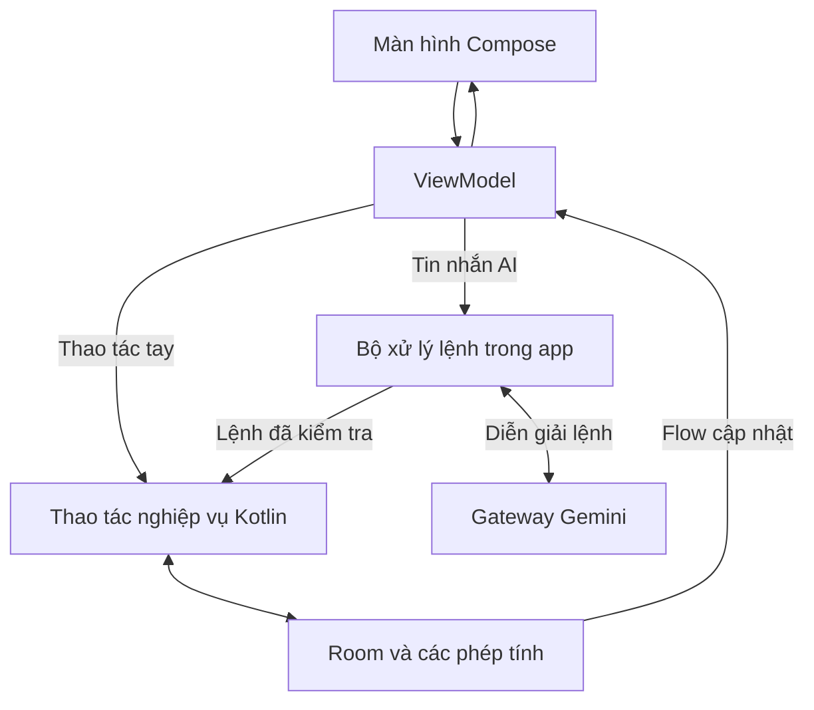

# Kiến trúc và dữ liệu Android

Với repo mới, bắt đầu bằng một module Android `:app` và chia package theo chức năng. Dùng Kotlin, Compose Material 3, Navigation Compose, ViewModel với `StateFlow`, Coroutines, Room và DataStore. Có thể dùng dependency injection nhẹ theo cấu trúc repo. Gateway Gemini là tiến trình riêng, chỉ phục vụ diễn giải lệnh.

## Dòng dữ liệu

- Màn hình lấy state từ ViewModel và phát sự kiện. ViewModel điều phối thao tác và hiển thị. Repository đọc/ghi Room. Các hàm tính tiền và quy tắc trạng thái dùng chung cho UI, AI và xuất sổ.
- Cho inject đồng hồ ngày nghiệp vụ và bộ cung cấp Gemini để test được ngày chuyển tháng, lỗi mạng và các lệnh lặp. Dùng `LocalDate`/`YearMonth` cho ngày/kỳ và timestamp UTC cho lịch sử, hiển thị theo giờ Việt Nam.
- VND giao dịch dùng `Long` và kiểm tra giới hạn. Bù giá gạo giữ độ chính xác theo [quy tắc nghiệp vụ](02_NGHIEP_VU.md). Phân biệt giá trị trống, 0 và chưa cấu hình. Dùng các phép tính thuần có kết quả ổn định để so với fixture.

## Mô hình Room đề xuất

Đây là tên gợi ý cho thực thể. Khi đã có repo, dùng lại bảng và tên hiện có nếu đáp ứng được quan hệ và ràng buộc.

| Thực thể | Trường và ràng buộc quan trọng |
|---|---|
| `Person`, `MembershipPeriod` | ID ổn định, tên hiển thị, nhóm, hiệu lực vào/rời. Đổi nhóm có mốc, khóa ngoại tới người |
| `MealSchedule`, `GuestRegistration` | Người/đoàn, bữa, phạm vi ngày, trạng thái; giữ thông tin đăng ký/hủy. Một khách đích danh có tối đa một suất mỗi ngày/bữa |
| `DayDraft`, `MealOverride` | Ngày duy nhất, phiên bản, trạng thái. Override cho người hoặc lượt khách, khóa duy nhất theo đối tượng/ngày/bữa. Điểm danh có cột/bảng riêng |
| `MealMenu`, `MealMenuItem` | Khóa ngày/bữa, trạng thái món thường hoặc Có kế hoạch riêng. Món có vị trí và tên. Ô sáng ngày kế tiếp truy cập khóa của ngày đó |
| `MealRate`, `RiceSubsidyRate` | Mức theo bữa/ngày hiệu lực, phí từng loại, gram và VND/kg. Ràng buộc mức đang hiệu lực duy nhất trong phạm vi. Ngày nháp có thể lưu phí riêng khi người dùng chỉnh cho ngày đó |
| `DayCloseRevision`, `ClosedMeal` | Phiên bản chốt, lý do, ảnh chụp các suất, nhóm, định mức và thực đơn của ngày. Một bản đang hiệu lực mỗi ngày. Có thể lưu chỉ số đã mua lúc chốt để đối chiếu |
| `CashEntry`, `PaymentAllocation` | Giao dịch thực tế, loại, số tiền, ngày phát sinh, kỳ nghiệp vụ. Phân bổ tổng đúng giao dịch cha, giữ đối tượng lúc thu |
| `Settlement` | Hoàn hoặc cấn trừ, người/kỳ đi và kỳ đến, số tiền, trạng thái, giao dịch liên quan khi hoàn thực tế |
| `Note` | Ghi chú, ghim, thời gian |
| `AuditEvent`, `OperationReceipt` | Audit chỉ thêm, nguồn, đối tượng và trước/sau cần đối chiếu. Receipt liên kết kết quả đã lưu với mã thao tác duy nhất |
| `ChatMessage`, `AssistantAction` | Tin nhắn, ngữ cảnh lúc gửi, bản xem trước, trạng thái, `traceId`, `requestId`, `operationId` khi có lệnh ghi và phiên bản dữ liệu |

Dùng chỉ mục cho ngày, kỳ, người và truy vấn sổ tháng. Tái sử dụng cùng dòng giao dịch cho tổng tiền mua ngày và tháng. Ghi dữ liệu, phân bổ, trạng thái lệnh thành công, Audit và receipt trong cùng transaction. Chọn duy nhất bản chốt đang hiệu lực khi tổng hợp. Dùng dữ liệu mẫu cố định cho phát triển và Room schema export/migration test khi nâng schema.

Khởi tạo bộ ghi Technical Log độc lập với Room để màn chẩn đoán còn đọc được log khi lỗi mở database. Xem [Database và log](09_DATABASE_VA_LOG.md) để áp dụng khóa thao tác, phiên bản và giới hạn dữ liệu. [AI Debug Center](10_AI_DEBUG_CENTER_VA_HANDOFF.md) lấy kết quả nghiệp vụ từ Room và dòng thời gian từ bộ log kỹ thuật.

## Chốt và sửa ngày

1. Tạo bản xem trước từ dữ liệu, kiểm tra các trường phải có, lưu số phiên bản mà màn hình đã đọc.
2. Khi xác nhận, trong transaction kiểm tra phiên bản, tạo bản chốt và các dòng đã áp dụng, cập nhật trạng thái ngày và ghi lịch sử. Cùng một mã thao tác trả lại kết quả đã lưu nếu gửi lại.
3. **Chuẩn bị ngày mai** dùng cơ chế tạo nếu chưa có theo khóa ngày. Mở bản đang tồn tại khi người dùng đã chuẩn bị trước. Chuyển màn khi ngày chốt đã được lưu.
4. Với điều chỉnh, giữ nguyên bản đang hiệu lực trong lúc chuẩn bị sửa. Khi xác nhận bản sửa, đổi bản hiệu lực một lần và đánh dấu kỳ cần đối soát nếu giao dịch hoặc quyết toán liên quan đã hoàn tất.

## Sao lưu, khôi phục và xuất sổ

- Sao lưu có schema version, thời điểm, số bản ghi và phạm vi. Dùng Storage Access Framework để chọn nơi lưu và chọn tệp khôi phục. Có thể chọn định dạng snapshot dữ liệu có phiên bản hoặc cơ chế sao lưu Room nhất quán, rồi ghi cách khôi phục trong README.
- Đọc và xác thực cấu trúc trước khi áp dụng, hiện tóm tắt để xác nhận. Chọn thao tác giữ nguyên DB nếu lỗi giữa chừng. Tạo bản sao trước khi thay dữ liệu. Kiểm thử vòng sao lưu → khôi phục → so số liệu. Khóa truy cập Gemini và token kết nối được thiết lập riêng trên thiết bị.
- Bản sao nghiệp vụ giữ lịch sử Audit và receipt tương ứng. Log kỹ thuật và file xuất chẩn đoán theo vòng đời riêng. Khi khôi phục, kiểm tra lại các thẻ AI đang chờ xác nhận.
- Xuất sổ XLSX dùng tháng, nhóm, bản chốt và các giao dịch đúng phạm vi. Giữ ngày nháp phân biệt trong báo cáo xem. Kiểm tra thư viện phù hợp Android và mở lại trong Excel. Nếu cần khớp mẫu nộp chính thức, đối chiếu mẫu đã duyệt trước khi chốt bố cục in. Giữ giao dịch quỹ và số theo suất có nhãn riêng.

## Xuất ảnh và chia sẻ đúng vùng

1. Lấy trạng thái thẻ thực đơn đã lưu, đủ bốn ô kể cả bữa sáng ngày kế tiếp, và dựng một vùng hiển thị riêng gồm tiêu đề và nội dung. Có thể dùng bố cục Compose được đo/render riêng hoặc renderer Canvas dùng cùng token, font và dữ liệu. Ảnh dùng bề mặt đặc.
2. Đo chiều cao theo số dòng và cỡ chữ xuất ảnh, tạo PNG rõ ở chiều rộng mục tiêu, ví dụ 1080px. Với thực đơn dài, xử lý kích thước bitmap và lỗi bộ nhớ để người dùng thử lại. Dùng ảnh nguyên bốn ô khi thao tác thành công.
3. Lưu vào thư mục cache riêng được khai báo cho `FileProvider`. Dùng `content://` và MIME `image/png`. **Sao chép** dùng `ClipData.newUri` và clipboard của Android. **Chia sẻ** dùng `ACTION_SEND`, `EXTRA_STREAM`, quyền đọc URI tạm thời và Sharesheet. Giữ ảnh cache đủ lâu cho app nhận đọc.
4. Thử dán ảnh bằng một ứng dụng hỗ trợ và thử chọn app qua Sharesheet trên điện thoại. Kiểm tra PNG có tiêu đề, đúng bốn ô, phần dài cuối ảnh và vùng kết thúc trước các nút.

Tài liệu triển khai chính thức. [Offline-first](https://developer.android.com/topic/architecture/data-layer/offline-first) · [Room migration](https://developer.android.com/training/data-storage/room/migrating-db-versions) · [Storage Access Framework](https://developer.android.com/training/data-storage/shared/documents-files) · [Clipboard Compose](https://developer.android.com/develop/ui/compose/touch-input/copy-and-paste) · [Chia sẻ nội dung](https://developer.android.com/develop/ui/compose/sharing/send)
